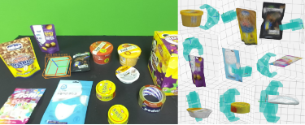

# Grasp Workbench

English | [한국어](README.ko.md)

**An example of optional workers that take an RGB-D camera all the way to object meshes, poses and grasp candidates.**

You bring your own camera, VLM, models and gripper. This repository connects each function as an independent process over
**iceoryx2** and gives a minimal integration example where you turn on only the stages you need in YAML.
FFW and ROS are not required, and **it never moves a real robot or sends joint commands.**



## Contents

- [Quick start](#quick-start)
- [Choosing which stages to use](#stages)
- [YAML configuration](#configuration)
- [Choosing a VLM](#vlm)
- [UI workflow](#workflow)
- [Documentation and repository layout](#documentation)
- [Verification](#verification)
- [Notes on sharing](#sharing)
- [Status](#status)

## Features

| Feature | Role |
|---|---|
| Camera | Example connections for ZED and RealSense RGB-D |
| VLM · optional | Recognizes objects, English prompts and task roles with the GPT API / Codex CLI / Claude API |
| SAM3 | Continuous segmentation for two prompts (A/B), candidate selection, box/point refinement |
| SAM3D · optional | Builds a mesh from a frozen RGB-D frame and mask; can be skipped if a mesh already exists |
| FoundationPose | Mesh registration and continuous pose tracking, video overlay and 3D mesh view |
| AprilCube · alternative mode | Tag-based A/B pose estimation and RGB overlay of a chosen mesh; the regular model workers do not run |
| GraspGenX | Generates, stores and reuses grasp candidates for a mesh |
| Grasp selection · optional | Single-arm / dual-arm candidate selection; with a robot connected, base-frame transform and endpoint IK check |
| Recording · optional | Independent LeRobotDataset recorder for original RGB-D and A/B pose results |

**A/B are object slots, not left/right arms.** The VLM produces semantic information; it does not estimate masks, numeric poses or real contact states.

<a id="quick-start"></a>
## 1. Quick start

### Install the repository and the base UI environment

The supported setup is a **Git checkout with an editable install (`-e`)**.

```bash
git clone --recurse-submodules https://github.com/AnJunHo98/grasp_workbench.git
cd grasp_workbench
python3 -m venv .venv
source .venv/bin/activate
python -m pip install -e '.[ui,test]'
```

If you have already cloned it, fetch the submodules with `git submodule update --init --recursive`.
A standalone wheel that bundles the root YAML, meshes and submodules is not supported.

### Prepare the camera

| Camera | What else you need |
|---|---|
| ZED · default | The ZED SDK for your device and `pyzed` in the current Python environment |
| RealSense | `python -m pip install -e '.[realsense]'`, plus the device, driver and access permissions |

Fetching the submodules does not install any camera SDK or model environment.
See the [setup guide](docs/setup.md#camera) for each camera.

### Create your local config and run

```bash
# Does not overwrite an existing config.local.yaml.
cp -n examples/config.local.example.yaml config.local.yaml
```

Choose the camera type in `config.local.yaml`. For example, with RealSense:

```yaml
camera:
  type: realsense          # zed / realsense
  serial: null             # null: the SDK's default device
```

The shared defaults and the example file have **the camera and UI on and every optional model off**.
To use a model, turn it on following the stage table below and prepare its [installation and paths](docs/setup.md).

```bash
grasp-workbench run
```

Ctrl+C or closing the UI stops that run's workers. A normal run does not need long command-line options.

<a id="stages"></a>
## 2. Choosing which stages to use

The values in this table are each YAML section's **`enabled`**. They assume the manual flow with the VLM off; you can combine rows as needed.

| What you want | `sam3` | `sam3d` | `foundationpose` | `graspgenx` | `grasp_selection` |
|---|---|---|---|---|---|
| Camera view only | false | false | false | false | false |
| Up to masks | true | false | false | false | false |
| Up to mesh generation | true | true | false | false | false |
| Pose with an existing mesh | true | false | true | false | false |
| Pose after generating a new mesh | true | true | true | false | false |
| Grasp candidates for a mesh file only | false | false | false | true | false |
| Selection / dual-arm pairing of saved grasps only | false | false | false | false | true |
| New mesh → pose → grasp → selection | true | true | true | true | true |

- **To use VLM recognition**, add `vlm.enabled: true` and the backend settings to the combination above.
- **`enabled: true` starts the worker.** It does not mean every inference runs before you press a button.
  SAM3 processes continuously after a prompt is applied; the others run on a button press or an explicit VLM/Task request.
- Each model worker is turned on separately. Turning on the VLM, FP or SAM3D does not start the SAM3 backend.
- `run` always starts the camera. **There is no `camera.enabled`.**
- If any model is on, the UI is used even with `ui.enabled: false`. To check only the camera from the console, turn every model off
  and set `ui.enabled: false`. This is not a headless model-execution setting.

### AprilCube alternative mode

```yaml
aprilcube:
  enabled: true
  fast: true
```

This mode runs four processes: **Camera + AprilCube Pose + AprilCube Overlay + UI**.
With `recording.enabled: true` the independent recording worker runs as well. VLM, SAM3, SAM3D, FoundationPose, GraspGenX and
grasp selection do not run even if they are set to `true`. The YAML itself is not changed, so setting AprilCube back to
`false` restores your previous setup. Poses are published on the existing FoundationPose result channel, marked with
source `aprilcube`. [Installation, cube definitions, mesh placement and IPC](docs/aprilcube.md)

### Optional LeRobot data recording

The independent recorder uses **LeRobotDataset 0.6.1 APIs only**; it does not replace the camera worker,
run LeRobot robot control, or train a policy. Use a separate Python 3.12+ environment for its optional dependencies.

```yaml
recording:
  enabled: true
  python: .venv-recorder/bin/python
  output_dir: runs/datasets
  fps: 30
  source: pose            # pose / camera
```

Run `grasp-workbench run`, then use **Recording → Start Recording / Save Episode / Discard Episode**.
`pose` records each received pose result with its exact source RGB-D, including unavailable A/B poses;
it waits for AprilCube or FoundationPose results. Use `camera` for RGB-D-only collection without a pose worker.
The recorder stays available in AprilCube mode. [Installation and storage contract](docs/recording.md)

<a id="configuration"></a>
## 3. YAML configuration

| File | Purpose |
|---|---|
| [`config.yaml`](config.yaml) | Shared defaults and the full configuration structure |
| `config.local.yaml` | Per-user on/off switches, devices, model paths and credential file paths. Git-ignored |
| [`examples/config.local.example.yaml`](examples/config.local.example.yaml) | Full example to start your local config from |
| [Per-model setup](docs/setup.md) | Checkpoints, separate Python environments, VLM credentials |

A normal `run` reads the repository's `config.yaml` and overrides **only the keys present in `config.local.yaml`.**
Paths are resolved relative to the repository, not the current directory: a relative path is relative to the folder of the YAML file that defines it,
and `python: null` for a model means the Python that is currently running.

The main optional settings are below. Whether each worker is enabled, and each model's required paths, are set separately.

```yaml
sam3d:
  depth_source: depth       # depth: measured RGB-D / monocular: depth predicted from RGB
  texture_baking: false     # true: textured GLB that keeps UVs and materials

graspgenx:
  gripper_id: franka_panda  # gripper ID you prepared
  assets_dir: null          # null: GraspGenX default assets; or a custom descriptor path

grasp_selection:
  robot_config: null        # null: object-local candidate selection and display without a robot
```

`depth` results use metre coordinates from measured depth. `monocular` gives a **predicted scale**; real size and distance are not guaranteed.
Texture only affects surface appearance and is not required for pose or grasp generation. [Size, coordinates and cache](docs/usage.md#sam3d)

<a id="vlm"></a>
## 4. Choosing a VLM

Set **`backend` and `model`** together in the flat `vlm` section. With the VLM off you type the A/B prompts in the UI.

| `backend` | Connection | What you need |
|---|---|---|
| `openai_api` | GPT / OpenAI Responses API | `.[vlm]`, your own model ID and API key |
| `codex_cli` | One-shot recognition with an installed Codex CLI | CLI installed and logged in with your own account, Python Pillow |
| `anthropic_api` | Claude Messages API | `.[vlm-anthropic]`, your own model ID and Anthropic API key |

Use **one of the three `vlm` blocks below** in your local config. Environment creation, SDK installation and login are in the
[setup guide](docs/setup.md).

### GPT API

```yaml
vlm:
  enabled: true
  python: .venv-vlm/bin/python
  backend: openai_api
  model: gpt-6.1-sol
  api_key_file: .secrets/openai_api_key.txt
```

[GPT API setup and authentication](docs/setup.md#vlm-openai)

### Codex CLI

```yaml
vlm:
  enabled: true
  python: .venv-vlm/bin/python
  backend: codex_cli
  model: gpt-6.1-sol
  codex_executable: codex
  api_key_file: null
```

Uses the login state of the CLI you installed; it does not read an API key file.
[CLI installation and login](docs/setup.md#vlm-codex)

### Claude API

```yaml
vlm:
  enabled: true
  python: .venv-vlm-anthropic/bin/python
  backend: anthropic_api
  model: YOUR_CLAUDE_VISION_STRUCTURED_OUTPUT_MODEL_ID
  api_key_file: .secrets/anthropic_api_key.txt
```

Replace `model` with **a real model ID on your account that supports image input and structured output**.
This backend does not use the Claude Code CLI. [Claude API setup and authentication](docs/setup.md#vlm-anthropic)

- Changing the backend does not change the model name or credentials. There is no automatic fallback to another provider on failure.
- For the API backends, `api_key_file: null` uses the `OPENAI_API_KEY` / `ANTHROPIC_API_KEY` environment variable.
- Never put key values in YAML. Each user keeps them in a Git-ignored file or an environment variable.
- To add another VLM, register an adapter that returns the common result in the existing VLM worker. [Adding another VLM](docs/setup.md#custom-vlm)

<a id="workflow"></a>
## 5. UI workflow

The top bar holds the **VLM instruction, the recognition button and status**; Source/Target role editing and task details are collapsed below it.
Choosing a worker tab on the left shows only that function's inputs and buttons, while the **live RGB and Mesh / Pose 3D view** on the right stay the same.

| Left tab | Main actions |
|---|---|
| Camera | Device and stream status; connects automatically on start |
| SAM3 | Apply A/B prompts, stop segmentation, choose candidates, refine masks |
| SAM3D | Generate A/B meshes and choose results |
| FoundationPose | Choose A/B mesh and scale, start/re-register/stop tracking, track after generating a mesh |
| GraspGenX | Generate / regenerate A/B candidates, load existing candidates · bundles |
| Grasp Selection | Single/dual-arm mode and targets, choose and re-evaluate candidates |
| AprilCube | Apply A/B mesh, scale and cube→mesh XYZ/RPY |
| Recording | Start Recording / Save Episode / Discard Episode; dataset path and frame count |

**Workers are switched on and off only in YAML.** Choosing a tab does not start or stop a process or request inference.
A tab for a worker that is off only shows an OFF notice; in AprilCube mode only Camera, AprilCube and a separately enabled Recording are active.
FP seed refinement, display-only hand FK and robot details are in each tab's **Advanced** area.

### Manual prompts

1. **Segment:** in the SAM3 tab, enter two different English prompts for A/B and press **Apply · start segmentation**, e.g. `cell phone`, `yellow tuna can`.
   There is no automatic translation; if SAM3 finds several candidates, choose the one to use.
2. **Mesh / pose:** in the FoundationPose tab, for an existing mesh choose the file and scale and press **Start tracking · re-register**; for a new mesh
   request **Track after generating mesh**. **Generate mesh** in the SAM3D tab only creates the mesh.
3. **Display:** SAM3 masks and FP pose axes are drawn over the latest camera RGB; check the mesh and pose in the 3D plot on the right.
4. **Grasp:** generate candidates with GraspGenX or load an existing bundle, then request single- or dual-arm selection.
   You can also view only the object-local grasp candidates of a mesh file, without FP.

### With the VLM

Turn the VLM on in YAML, type an instruction in the top bar and press **Recognize · proceed** to recognize the current RGB frame.

- If an existing asset ID is chosen, FP starts with the saved mesh; a new object goes through SAM3D first and then FP.
- Within the enabled functions, the flow continues from FP to **looking up or generating the Source grasp cache, then candidate selection**.
- Source/Target are task roles of the objects, not arm assignments. Changing a role manually clears the previous semantic arm assignment.
- VLM recognition does not run every frame. With FP off, only the prompts and semantic results are applied.

While refining a mask the original RGB-D frame is frozen; press **Back to live** to return.
The default UI has no separate snapshot capture/save/load or session save/load/export buttons.
The existing file and save helper APIs remain. See [tab-by-tab actions, original inputs and advanced features](docs/usage.md).

<a id="documentation"></a>
## 6. Documentation and repository layout

| Document | Contents |
|---|---|
| [Setup](docs/setup.md) | Per-camera, per-model and per-VLM environments, YAML examples, robot adapter preparation |
| [Detailed usage](docs/usage.md) | UI actions, Source/Target, units, coordinates and cache, IPC contracts |
| [Verification history](docs/verification.md) | Real-model, saved-input and mock-backend verification, and what is not verified |
| [AprilCube mode](docs/aprilcube.md) | Alternative worker selection, A/B cube definitions, RGB mesh overlay and common pose output |
| [LeRobot recording](docs/recording.md) | Optional recording environment, YAML settings, episode controls and stored features |
| [Bundled meshes](assets/meshes/README.md) | Mesh origin, original/optimized files and catalog |

```text
grasp_workbench/    # entry point, workers, camera, model adapters, IPC, Qt UI
config.yaml        # shared defaults
examples/          # local config and optional robot adapter examples
third_party/       # 7 official submodules, unmodified
assets/meshes/     # bundled object meshes and catalog
image/             # README example image
docs/              # detailed setup, usage and verification docs
runs/              # generated assets, grasp caches, snapshots, datasets, logs: Git-ignored
```

Each function runs as an independent worker process. Images, masks, meshes, poses and requests/results between workers go over iceoryx2.
The original SDKs and upstream repositories are not modified, and no specific FFW or ROS environment is required.

<a id="verification"></a>
## 7. Verification

The local verification environment is **Linux x86_64 with Python 3.12.3**; the latest full run passed **1153 tests (2 optional-dependency tests skipped) and Ruff checks**.
This does not mean a full installation or hardware run on a new PC has been verified.

```bash
python -m pytest tests -q
# Optional: install Ruff separately.
python -m pip install ruff
ruff check grasp_workbench tests
```

- The automated tests combine mock SDKs and models with real independent processes, iceoryx2 and an offscreen UI.
- Replay checks with real models on saved RGB-D and checks with a real camera are listed separately in the [history](docs/verification.md).
- **Live Claude service calls, real monocular and texture inference, and measured robot hand FK are not verified.**
  For Claude, the real SDK's offline mock HTTP serialization and parsing were checked.
- IK only checks **whether the pregrasp/grasp endpoints are reachable**. It does not guarantee freedom from scene collisions, a planned path, or a successful real grasp.

<a id="sharing"></a>
## 8. Notes on sharing

- Do not share `.secrets/`, `.env*`, `config.local.yaml`, CLI credentials, `.venv*/`, weights or `runs/`.
  `.gitignore` does not apply to a ZIP of the whole folder; check already tracked files and past commits separately.
- The code and the 45 bundled meshes in this repository are under the MIT License ([LICENSE](LICENSE)). The bundled meshes come from the author's own object library.
  The `third_party/` submodules and each model's weights follow their upstream licenses.
- This example does **not** include robot control or motion, training, policy execution, or trajectory and scene collision checks.

<a id="status"></a>
## 9. Status

Development version `0.1.0`; features have been added and verified one at a time since 2026-10-20. The most recent additions are
the AprilCube alternative mode and LeRobot recording; the dated verification log is in [Verification history](docs/verification.md).
